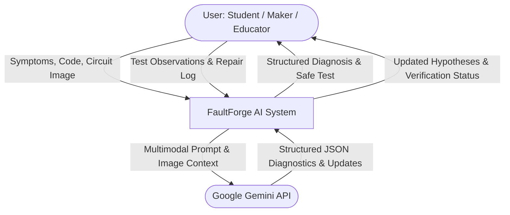
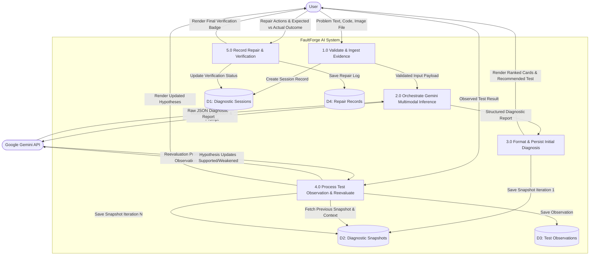
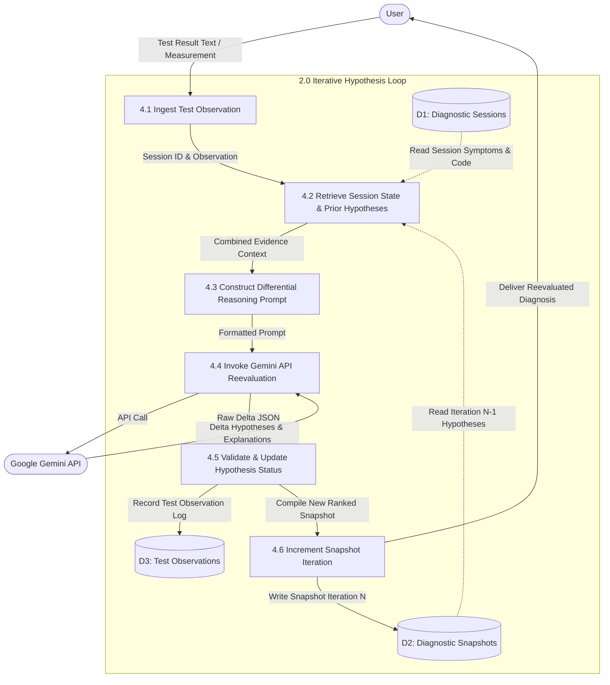

# FaultForge AI — Data Flow Diagrams (DFD)

## 1. Overview of Data Flow

This document specifies the Data Flow Diagrams (DFD) for **FaultForge AI** across three levels of abstraction:
- **Level 0 (Context Diagram)**: High-level boundary view showing external entities and primary data exchanges.
- **Level 1 DFD**: Subsystem breakdown showing ingestion, AI multimodal analysis, persistence, and verification.
- **Level 2 DFD**: Detailed data flow within the iterative hypothesis reevaluation cycle.

---

## 2. External Entities, Processes, and Data Stores

### External Entities
- **User (Student / Maker / Educator)**: Submits symptoms, code, photos, test observations, and repair verification reports.
- **Google Gemini API**: External cloud AI engine providing multimodal visual/code inference and hypothesis ranking.

### Data Stores
- **D1: Diagnostic Sessions**: Stores session metadata, problem statements, and lifecycle states.
- **D2: Diagnostic Snapshots**: Stores historical iterations of ranked hypotheses, evidence, and safety notes.
- **D3: Test Observations**: Stores user-conducted test results and differential diagnostic interpretations.
- **D4: Repair Records**: Stores physical fix actions and verified operational outcomes.

---

## 3. Level 0: Context-Level DFD

---

## 4. Level 1: Subsystem DFD

---

## 5. Level 2: Diagnostic Iteration & Reevaluation DFD

