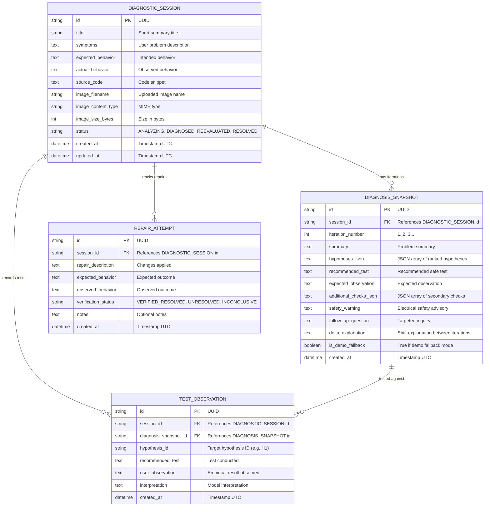

# FaultForge AI — Database Design

## 1. Overview and Rationale

FaultForge AI uses **SQLite** combined with **SQLAlchemy 2.0 ORM** for lightweight, reliable, zero-configuration local persistence. The schema is fully normalized to record the multi-iteration lifecycle of a troubleshooting case: initial evidence ingestion, progressive diagnostic snapshots, user test observations, and repair attempts.

---

## 2. Entity-Relationship Diagram (ERD)



---

## 3. Data Dictionary

### Table: `diagnostic_sessions`
| Column Name | Type | Constraints | Description |
| :--- | :--- | :--- | :--- |
| `id` | VARCHAR(36) | PRIMARY KEY | UUID identifier |
| `title` | VARCHAR(255) | NOT NULL | Generated title from symptoms |
| `symptoms` | TEXT | NOT NULL | User problem description |
| `expected_behavior`| TEXT | NULLABLE | Intended operational state |
| `actual_behavior` | TEXT | NULLABLE | Actual observed symptom |
| `source_code` | TEXT | NULLABLE | Embedded sketch or firmware code |
| `image_filename` | VARCHAR(255) | NULLABLE | Name of attached photograph |
| `image_content_type`| VARCHAR(100) | NULLABLE | MIME type (e.g. image/jpeg) |
| `image_size_bytes` | INTEGER | NULLABLE | File size in bytes |
| `status` | VARCHAR(50) | NOT NULL, DEFAULT 'DIAGNOSED' | Case lifecycle status |
| `created_at` | DATETIME | NOT NULL | UTC creation timestamp |
| `updated_at` | DATETIME | NOT NULL | UTC modification timestamp |

### Table: `diagnosis_snapshots`
| Column Name | Type | Constraints | Description |
| :--- | :--- | :--- | :--- |
| `id` | VARCHAR(36) | PRIMARY KEY | UUID identifier |
| `session_id` | VARCHAR(36) | FOREIGN KEY (sessions.id) ON DELETE CASCADE | Parent diagnostic session |
| `iteration_number` | INTEGER | NOT NULL, DEFAULT 1 | Iteration counter (1, 2, 3...) |
| `summary` | TEXT | NOT NULL | AI technical problem summary |
| `hypotheses_json` | TEXT | NOT NULL | JSON array of `Hypothesis` objects |
| `recommended_test` | TEXT | NOT NULL | Actionable safe diagnostic test |
| `expected_observation` | TEXT | NOT NULL | Expected observation for distinction |
| `additional_checks_json` | TEXT | NULLABLE | JSON list of secondary checks |
| `safety_warning` | TEXT | NULLABLE | High/low voltage safety note |
| `follow_up_question` | TEXT | NULLABLE | Request for missing evidence |
| `delta_explanation` | TEXT | NULLABLE | Explanation of shifts since prior iteration |
| `is_demo_fallback` | BOOLEAN | NOT NULL, DEFAULT FALSE | Flag indicating demo fallback mode |
| `created_at` | DATETIME | NOT NULL | UTC timestamp |

### Table: `test_observations`
| Column Name | Type | Constraints | Description |
| :--- | :--- | :--- | :--- |
| `id` | VARCHAR(36) | PRIMARY KEY | UUID identifier |
| `session_id` | VARCHAR(36) | FOREIGN KEY (sessions.id) ON DELETE CASCADE | Parent diagnostic session |
| `diagnosis_snapshot_id`| VARCHAR(36)| FOREIGN KEY (snapshots.id) ON DELETE SET NULL | Associated snapshot |
| `hypothesis_id` | VARCHAR(50) | NULLABLE | Target hypothesis tested |
| `recommended_test` | TEXT | NOT NULL | Test performed |
| `user_observation` | TEXT | NOT NULL | User measurement / observation |
| `interpretation` | TEXT | NULLABLE | Summary interpretation |
| `created_at` | DATETIME | NOT NULL | UTC timestamp |

### Table: `repair_attempts`
| Column Name | Type | Constraints | Description |
| :--- | :--- | :--- | :--- |
| `id` | VARCHAR(36) | PRIMARY KEY | UUID identifier |
| `session_id` | VARCHAR(36) | FOREIGN KEY (sessions.id) ON DELETE CASCADE | Parent diagnostic session |
| `repair_description` | TEXT | NOT NULL | Hardware / code fix applied |
| `expected_behavior` | TEXT | NULLABLE | Expected post-repair behavior |
| `observed_behavior` | TEXT | NOT NULL | Actual post-repair behavior |
| `verification_status`| VARCHAR(50) | NOT NULL | `VERIFIED_RESOLVED`, `UNRESOLVED`, `INCONCLUSIVE` |
| `notes` | TEXT | NULLABLE | Resolution notes |
| `created_at` | DATETIME | NOT NULL | UTC timestamp |

---

## 4. Example Record Data

```json
{
  "session": {
    "id": "b82d857d-7484-4cdc-96d7-1be4bdec5b5f",
    "title": "Arduino Uno pin 13 LED circuit does not light up",
    "status": "RESOLVED",
    "created_at": "2026-10-23T03:50:00Z"
  },
  "snapshot_iteration_1": {
    "iteration_number": 1,
    "top_hypothesis": "Reversed LED Polarity",
    "confidence_score": 0.82,
    "recommended_test": "Safely reverse LED legs or measure pin 13 voltage"
  },
  "observation": {
    "user_observation": "Reversed LED: Still dark, 0V measured at pin 13."
  },
  "snapshot_iteration_2": {
    "iteration_number": 2,
    "top_hypothesis": "Software Pin Mismatch",
    "status": "SUPPORTED",
    "confidence_score": 0.92
  },
  "repair": {
    "repair_description": "Updated pinMode and digitalWrite from pin 12 to 13 in sketch.",
    "verification_status": "VERIFIED_RESOLVED"
  }
}
```
