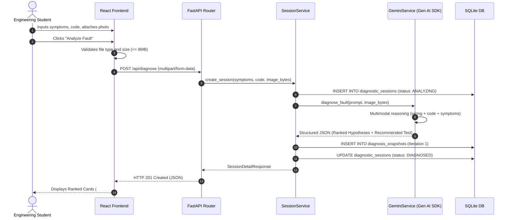
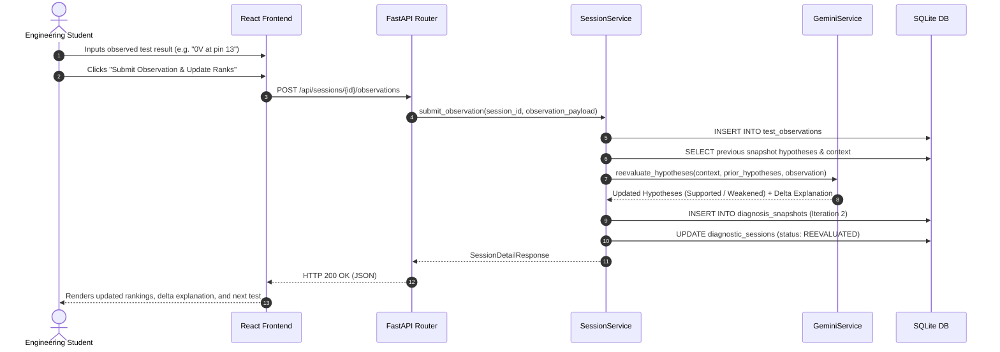
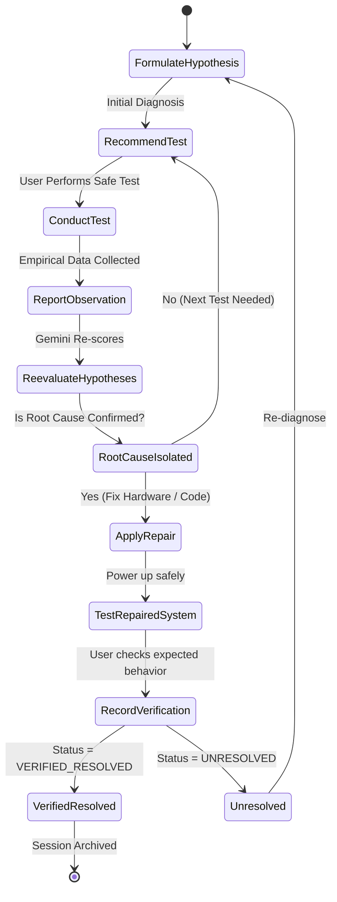
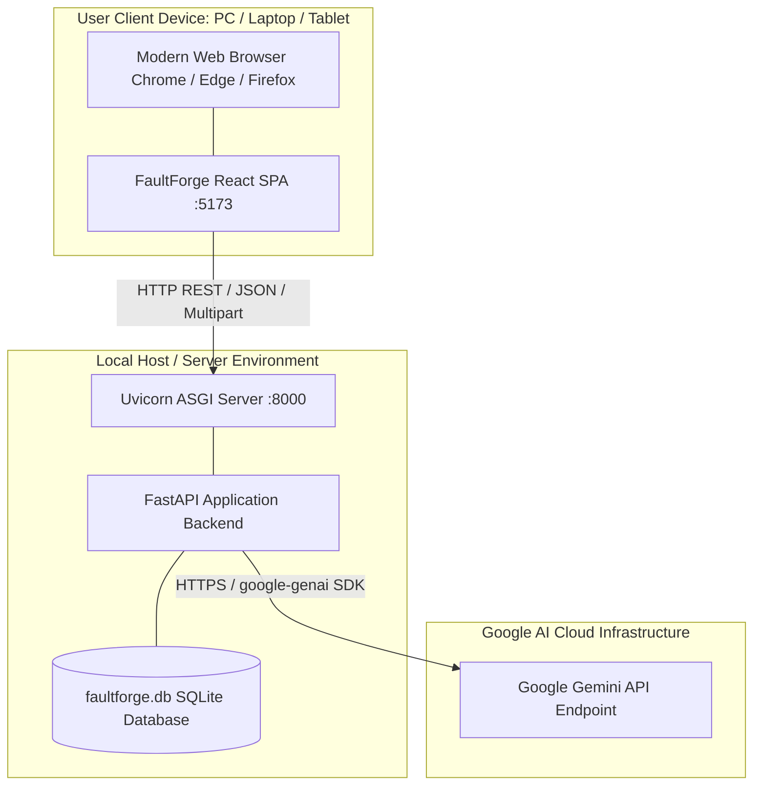

# FaultForge AI — UML Diagrams

## 1. Sequence Diagram: Initial Multimodal Diagnosis

---

## 2. Sequence Diagram: Evidence-Based Reevaluation

---

## 3. Activity Diagram: Repair Verification Workflow

---

## 4. Deployment Diagram

